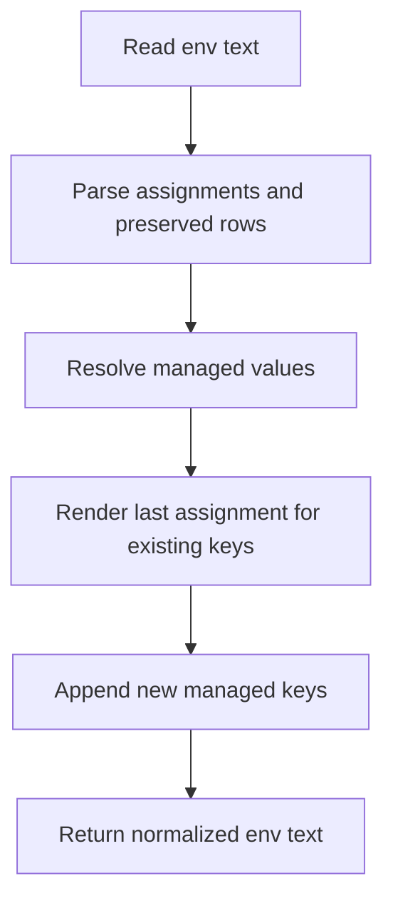

# @gg-utils/env-materialize-core

Product-neutral `.env` parsing and merge-aware rendering primitives.

Use this package when you need to read an env document, preserve comments and unrelated lines, update
managed keys, and write a normalized result without losing user-owned content.

## Install

```bash
npm install @gg-utils/env-materialize-core@git+https://github.com/gg-utils/env-materialize-core.git#v0.2.0
```

Pin a commit for reproducible consumers:

```json
{
  "dependencies": {
    "@gg-utils/env-materialize-core": "git+https://github.com/gg-utils/env-materialize-core.git#v0.2.0"
  }
}
```

## When To Use

- You need to parse `.env` files into assignments plus preserved non-assignment rows.
- You need "last assignment wins" behavior for duplicate keys.
- You need to render updated key/value pairs without deleting comments or unrelated lines.
- You are building a higher-level env materialization workflow, CLI, or UI.

Skip this package when target selection, secret loading, app-specific default values, or filesystem
write policy belongs in a consuming adapter.

## Public Surfaces

| Import | Purpose |
|---|---|
| `@gg-utils/env-materialize-core` | Package root barrel for env document helpers. |
| `@gg-utils/env-materialize-core/env-document` | Explicit env parser/renderer subpath. |

## Quick Start

```ts
import {
  EnvMaterialize_parseEnvDocument,
  EnvMaterialize_renderDocument,
} from "@gg-utils/env-materialize-core/env-document";

const document = EnvMaterialize_parseEnvDocument("A=1\n# keep me\nB=2\n");
const rendered = EnvMaterialize_renderDocument({
  document,
  valuesByKey: new Map([
    ["B", "3"],
    ["C", "4"],
  ]),
});

console.log(rendered);
```

## Operational Flow



## Development

```bash
git clone https://github.com/gg-utils/env-materialize-core.git
cd env-materialize-core
npm run type-check
npm test
npm run build
```

Use `npm ci` to install the pinned development tools. `npm run lint` and `npm run check:dist` verify lint and committed build output.

## Use from another repository

Requires Node `>=22.0.0 <27`. Install the tagged dependency shown above; built ESM JavaScript and declarations are included, with no consumer build step.

## Layout

```text
.
|-- src/env-document.ts       # Parser and renderer implementation
|-- src/index.ts              # Root barrel
|-- dist/                     # Checked-in build output
|-- tsconfig.json             # Type-check config
|-- tsconfig.build.json       # Build config
`-- package.json              # Export map and scripts
```

## Caveats

- This package does not decide which files or keys should be managed.
- It performs synchronous file reads only through `EnvMaterialize_readEnvDocument`.
- It does not load secrets, infer environment profiles, or apply app-specific defaults.
